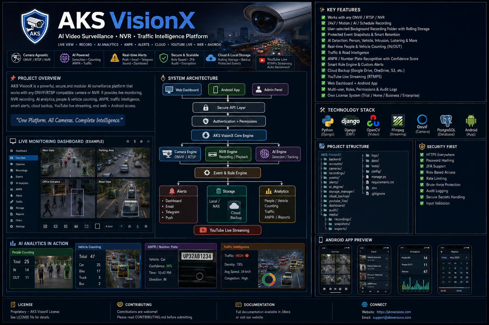
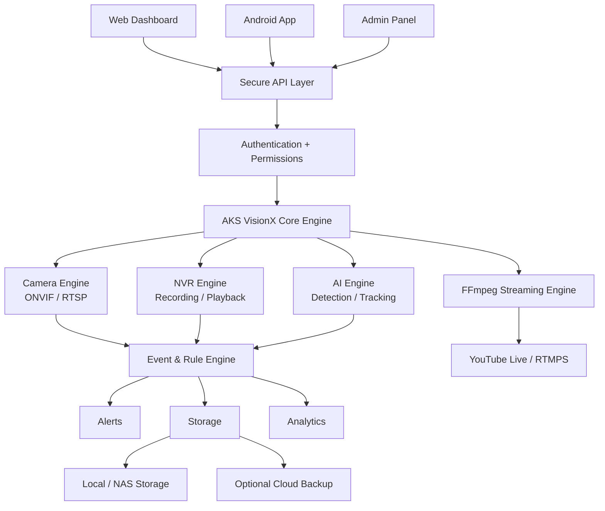

# 🛡️ AKS VisionX

<p align="center">
  <strong>AI Video Surveillance • NVR • Traffic Intelligence Platform</strong>
</p>

<p align="center">
  Secure, modular and camera/NVR-agnostic surveillance platform for live monitoring,
  recording, AI analytics, events, alerts, traffic intelligence and remote access.
</p>

<p align="center">


</p>

---

## 📸 Project Overview

<p align="center">
  
</p>

---

## 🚀 What is AKS VisionX?

**AKS VisionX** is a long-term, modular **AI Video Surveillance + NVR + Traffic Intelligence Platform**.

The core idea is simple:

```text
Camera / NVR
      ↓
Live Video
      ↓
Recording
      ↓
AI Analysis
      ↓
Detection & Tracking
      ↓
People / Vehicle Counting
      ↓
Traffic Intelligence
      ↓
ANPR / Number Plate Recognition
      ↓
Events & Rules
      ↓
Alerts & Evidence
      ↓
Analytics / Reports
      ↓
Web + Android + Optional Cloud
```

AKS VisionX is designed to work with different cameras and NVR systems instead of depending on a single camera manufacturer's application.

> **One Platform. All Cameras. Complete Intelligence.**

---

# 🎯 Project Goals

AKS VisionX aims to provide:

* 📷 Camera/NVR-agnostic architecture
* 🔴 Live camera monitoring
* 🎥 NVR-style recording
* 💾 Rolling local storage
* 🧠 AI object detection
* 👥 People counting
* 🚗 Vehicle counting
* 🛣️ Traffic intelligence
* 🔢 ANPR / number-plate recognition
* 🚨 Smart alerts
* ⚙️ Rule-based automation
* ☁️ Optional cloud backup
* 🔴 YouTube Live streaming
* 🌐 Web dashboard
* 📱 Android application
* 👥 User and role management
* 📝 Audit logs
* 📊 Reports and analytics
* 🪪 Future commercial licensing

---

# 🏗️ System Architecture



---

# 📷 Camera Integration

AKS VisionX will prioritize open standards.

### Integration priority

```text
ONVIF
  ↓
RTSP
  ↓
NVR ONVIF / RTSP
  ↓
Supported Vendor/API Adapter
```

### Example

```text
CP-T31A
   ↓
ONVIF / RTSP
   ↓
AKS VisionX
   ↓
Live Video
   ↓
Recording
   ↓
AI Analysis
```

If a camera or NVR does not expose a usable stream, protocol or supported API, software cannot access the video magically.

Hardware limitations are also respected:

* No microphone → no audio capture
* No PTZ hardware → no physical PTZ
* No usable stream/API → integration may not be possible

---

# 🧠 AI With Normal Cameras

The camera itself does not need to contain an AI processor.

```text
Normal Camera
      ↓
RTSP Video
      ↓
AKS VisionX
      ↓
Local AI Engine
      ↓
Detection
      ↓
Tracking
      ↓
Counting
      ↓
ANPR / Traffic Intelligence
```

AI performance depends on:

* Camera resolution
* FPS
* Number of cameras
* AI model
* CPU/GPU
* Available RAM
* Processing configuration

---

# ✨ Main Features

## 🔐 Authentication & Security

Planned authentication features:

* Registration
* Login
* Logout
* Forgot password
* Reset password
* Change password
* Session management
* Remember login
* Logout all devices
* Login history
* Failed login history
* Rate limiting
* Brute-force protection
* 2FA foundation

---

## 👥 User Management

Built-in roles:

```text
Super Admin
Admin
Operator
Viewer
```

Custom permissions will also be supported.

Example:

```text
Live View          ✓
View Recordings    ✓
Delete Recording   ✗
Add Camera         ✗
Manage Users       ✗
System Settings    ✗
```

---

# 📷 Camera Management

Features include:

* ONVIF discovery
* Manual camera addition
* RTSP configuration
* Camera name
* Camera location
* Main stream
* Sub-stream
* Camera credentials
* Camera health
* Camera status
* Automatic reconnect
* Camera groups
* Camera permissions
* Camera schedules
* NVR integration

---

# 🖥️ Live Monitoring

Dashboard layouts:

```text
1 Camera
4 Cameras
9 Cameras
16 Cameras
```

Features:

* Single camera
* Multi-camera grid
* Full screen
* Digital zoom
* Snapshot
* Audio where supported
* PTZ where supported
* Camera status
* Live AI overlays

---

# 🎥 NVR & Recording

### Recording Modes

* 24×7 recording
* Motion recording
* AI-event recording
* Manual recording
* Scheduled recording
* Event-based recording

### Advanced Recording

* Pre-event recording
* Post-event recording
* Timeline
* Playback
* Bookmark
* Protected recordings
* Screenshot
* Export
* Multi-camera playback

---

# 💾 Background Recording

Users can select their own recording folder.

Example:

```text
E:\CCTV-Recordings
```

When the application is minimized/backgrounded, recording can continue subject to:

* OS permissions
* PC power state
* Camera availability
* Network availability
* Storage availability

---

# ♻️ Rolling Storage

Example:

```text
Maximum Storage = 5 GB
```

Workflow:

```text
Recording
    ↓
Storage Folder
    ↓
5 GB Reached
    ↓
Find Oldest NORMAL Recording
    ↓
Delete Oldest Recording
    ↓
Continue Recording
```

Protected event recordings are excluded from normal cleanup.

Example:

```text
👤 Person Detected
🚗 Vehicle Detected
🚨 Intrusion
🔢 ANPR Event
🛣️ Traffic Event
```

These events can be protected according to the configured retention policy.

---

# 📸 Event Evidence

Important events can store:

```text
Event
 ├── Date
 ├── Time
 ├── Camera
 ├── Event Type
 ├── Snapshot
 ├── Recording
 └── AI Confidence
```

Event evidence can have a separate retention policy from normal rolling video.

Search options:

* Date
* Time
* Camera
* Event
* Person
* Vehicle
* Plate
* Location
* Traffic event

---

# 🧠 AI Engine

### Object Detection

* Person
* Vehicle
* Animal
* Motion
* Supported object categories

### Security Intelligence

* Intrusion detection
* Restricted-zone detection
* Line crossing
* Loitering
* Crowd detection
* Abandoned object
* Removed object
* Camera covered
* Camera tampering
* Unusual activity

AI models and dependencies will be selected with performance and commercial-use licensing compatibility in mind.

---

# 👥 Real-Time People Counting

Example:

```text
People: 25

IN:  14
OUT: 11
```

Planned capabilities:

* Total people
* IN/OUT counting
* Direction
* Zone-wise counting
* Occupancy
* Crowd count

---

# 🚗 Vehicle Counting

Supported categories will depend on the selected AI model.

Potential categories:

* Cars
* Bikes
* Motorcycles
* Trucks
* Buses
* Auto/rickshaw
* Other supported vehicle classes

Additional capabilities:

* Total vehicle count
* IN/OUT
* Direction
* Tracking
* Lane-wise counting

---

# 🛣️ Traffic Intelligence

For suitable road-camera deployments:

* Vehicle counting
* Lane counting
* Traffic density
* Congestion analysis
* Direction detection
* Peak traffic analysis
* Stopped vehicle detection
* Wrong-way detection
* Lane crossing
* Restricted-zone detection
* Traffic events
* Estimated speed where technically feasible

Example:

```text
ROAD — LIVE

Vehicles: 47
Cars:     25
Bikes:    17
Truck:     3
Bus:       2

Traffic: HIGH
```

---

# 🔢 ANPR / Number Plate Recognition

Target pipeline:

```text
Camera
   ↓
Vehicle Detection
   ↓
Vehicle Tracking
   ↓
Plate Detection
   ↓
Plate Crop
   ↓
OCR
   ↓
Plate Text
   ↓
Database
```

Example:

```text
Vehicle:    Car
Plate:      UP32AB1234
Confidence: 96%
Time:       10:42 PM
Direction:  IN
Camera:     Main Road
```

Low-confidence results should be marked for review rather than blindly treated as correct.

---

# 🚨 Smart Rule Engine

Rules can combine multiple conditions.

Example:

```text
IF

Person detected
AND
Camera = Main Gate
AND
Time = 22:00–06:00

THEN

Critical Alert
+
Snapshot
+
Recording Protection
```

Watchlist example:

```text
IF

Vehicle detected
AND
Plate = Watchlist Plate

THEN

Critical Alert
+
Snapshot
+
Recording Protection
```

Alert cooldowns will help prevent notification floods.

---

# 🔔 Alerts

Planned notification channels:

* Dashboard
* Desktop
* Email
* Telegram
* Android Push
* Sound
* Critical alerts

---

# 🔎 Smart Search

Structured search will support:

* Date
* Time
* Camera
* Location
* Event
* Person
* Vehicle
* Plate
* Traffic
* Intrusion

Future natural-language search:

> “Kal raat gate par vehicle wale events dikhao.”

---

# 🎬 Playback

Planned playback features:

* Timeline
* Event markers
* Play
* Pause
* Fast forward
* Rewind
* Bookmark
* Snapshot
* Export
* Download
* Multi-camera playback

---

# 💾 Storage

Supported storage targets:

* HDD
* SSD
* NAS
* User-selected folder
* Multiple storage locations

Storage monitoring:

```text
Storage: 72%
Recording: ACTIVE
Free Space: 280 GB
```

---

# ☁️ Cloud Backup

Optional cloud integrations may include:

* Google Drive
* OneDrive
* S3-compatible storage
* Other supported providers

Cloud backup is optional. Core local recording should not depend on cloud availability.

---

# 🔴 YouTube Live

Camera does not need native YouTube support.

```text
Camera
   ↓
RTSP
   ↓
AKS VisionX
   ↓
FFmpeg
   ↓
RTMPS
   ↓
YouTube
```

Planned features:

* Start
* Stop
* Stream profiles
* Resolution
* FPS
* Bitrate
* Stream health
* Auto reconnect
* Scheduling

YouTube should not be treated as the primary CCTV archive.

---

# 🌐 Web Application

Planned sections:

```text
Dashboard
Cameras
Live
Recordings
Events
AI Analytics
ANPR
Alerts
Traffic
Storage
Cloud
YouTube
Users
Reports
Settings
License
Audit
```

---

# 📱 Android Application

The Android application will communicate with the central backend.

```text
Android
   ↓
HTTPS
   ↓
AKS VisionX API
   ↓
Backend
   ↓
Camera / NVR
```

Planned features:

* Login
* Logout
* Live view
* Alerts
* Events
* Playback
* Snapshots
* Notifications
* Camera status
* User profile
* Secure remote access

Camera credentials should not be unnecessarily exposed to the Android client.

---

# 🩺 System Health

Example:

```text
CPU          32%
RAM          54%
Storage      68%
Network      GOOD

Camera 01    ONLINE
Camera 02    ONLINE
Camera 03    OFFLINE

AI           RUNNING
Recorder     RUNNING
```

---

# 📝 Audit Logs

The system should maintain audit records for important actions:

```text
Login
Logout
Failed Login

Camera Added
Camera Removed

Recording Deleted

User Created
Permission Changed

Settings Changed

YouTube Started

License Activated
```

---

# 📊 Reports

Planned reports:

* Camera uptime
* Offline cameras
* AI events
* People count
* Vehicle count
* Traffic statistics
* ANPR history
* Storage usage
* Alert history

Export:

```text
PDF
CSV
```

---

# 🗺️ Floor Plan / Camera Map

Users can create a visual camera layout.

```text
┌─────────────────────────┐
│ 📷 Camera 1             │
│                         │
│          🏢             │
│                         │
│ 📷 Camera 2       🚪    │
└─────────────────────────┘
```

Selecting a camera can open its live view.

---

# 🪪 Licensing

Future commercial licensing system:

```text
Trial
Home
Business
Professional
Enterprise
```

Potential license controls:

* License key
* Activation
* Expiry
* Renewal
* Revoke
* Camera limit
* Device limit
* Signed license
* Offline grace period
* License status

A separate authorized **License Admin/Generator** is planned.

---

# 🧰 Technology Stack

| Component | Technology                            |
| --------- | ------------------------------------- |
| Backend   | Python + Django                       |
| API       | Django REST Framework                 |
| Database  | SQLite → PostgreSQL                   |
| Video     | FFmpeg + OpenCV                       |
| Camera    | ONVIF + RTSP                          |
| AI        | Local / Open-source compatible models |
| OCR       | Local OCR engine                      |
| Frontend  | HTML / CSS / JavaScript initially     |
| Android   | Android client                        |
| Streaming | FFmpeg + RTMPS                        |
| Storage   | Local / NAS / Optional Cloud          |

> Final AI models and dependencies will be selected based on accuracy, performance, hardware requirements and commercial-use licensing.

---

# 📁 Project Structure

Target structure:

```text
AKS-VisionX/
│
├── backend/
├── accounts/
├── cameras/
├── recordings/
├── events/
├── alerts/
├── ai_engine/
├── storage_manager/
├── cloud_backup/
├── youtube_live/
├── dashboard/
├── audit/
│
├── media/
│   ├── recordings/
│   ├── snapshots/
│   └── exports/
│
├── logs/
├── docs/
├── tests/
├── config/
│
├── manage.py
├── requirements.txt
├── .env
└── .gitignore
```

The structure will be refined during implementation.

---

# 🔐 Security First

AKS VisionX will **not claim to be 100% unhackable**.

Instead, security will be treated as a core engineering requirement.

### Application Security

* HTTPS
* Secure password hashing
* Secure sessions
* API authentication
* Authorization
* CSRF protection
* Rate limiting
* Brute-force protection
* Input validation
* Security headers
* Secure file handling
* Secret management
* Audit logging

### Camera Security

* No hard-coded passwords
* Protected camera credentials
* No unnecessary public exposure
* Private-network/VPN architecture where appropriate
* Secure remote access

---

# ⚠️ Known Limitations

AKS VisionX will respect actual hardware and network limitations.

### Camera limitations

```text
No microphone
    ↓
No audio capture
```

```text
No PTZ hardware
    ↓
Software cannot create physical PTZ
```

```text
No accessible stream/API
    ↓
Integration may be impossible
```

### AI limitations

Low-quality or distant plates may reduce ANPR accuracy.

Weak hardware combined with many high-resolution cameras may reduce real-time AI performance.

### System limitations

If the PC is:

```text
OFF
or
SLEEPING
```

local recording cannot continue.

If the internet goes down:

```text
Remote Access     → Affected
Cloud Backup      → Affected
YouTube Live      → Affected

Local Recording   → Can continue
                    if local system/cameras remain available
```

---

# 🧪 Development Methodology

Every phase follows:

```text
BUILD
  ↓
TEST
  ↓
FIX
  ↓
VERIFY
  ↓
COMMIT
  ↓
NEXT PHASE
```

Example:

```text
Phase 4
   ↓
CP-T31A discovered
   ↓
RTSP verified
   ↓
Live verified
   ↓
Recording verified
   ↓
Reconnect verified
   ↓
TEST PASSED
   ↓
Phase 5
```

---

# 🏗️ Development Roadmap

## Phase 1 — Foundation

* Python environment
* Django
* Database
* Architecture
* Git
* Basic project configuration

## Phase 2 — Authentication

* Login
* Logout
* Registration
* Password management
* Sessions
* 2FA foundation

## Phase 3 — Users & Roles

* Super Admin
* Admin
* Operator
* Viewer
* Permissions

## Phase 4 — Camera Engine

* ONVIF
* RTSP
* Camera discovery
* NVR integration
* Multi-camera support

## Phase 5 — NVR

* Recording
* Playback
* Snapshots
* Pre-event recording
* Post-event recording

## Phase 6 — Storage

* Local folder
* Rolling storage
* Protected events
* NAS
* Storage monitoring

## Phase 7 — AI

* Object detection
* Tracking
* People counting
* Vehicle counting
* Traffic intelligence
* ANPR

## Phase 8 — Events & Alerts

* Event engine
* Rule engine
* Notifications
* Event history
* Smart search

## Phase 9 — Cloud

* Backup
* Retry system
* Cloud policies
* Provider integrations

## Phase 10 — YouTube

* Live streaming
* Profiles
* Health monitoring
* Auto reconnect

## Phase 11 — Web + Android

* Complete dashboards
* Remote access
* Android notifications
* Mobile events/playback

## Phase 12 — Production

* Security hardening
* Performance optimization
* Installer
* Updates
* Licensing
* Commercial deployment

---

# 🚀 Development Principle

The project will be developed incrementally rather than attempting to build every feature simultaneously.

```text
Foundation
    ↓
Authentication
    ↓
Users & Permissions
    ↓
Camera Integration
    ↓
Recording
    ↓
Storage
    ↓
AI
    ↓
Events
    ↓
Alerts
    ↓
Cloud
    ↓
YouTube
    ↓
Web + Android
    ↓
Production
```

---

# 💻 Planned Local Workspace

```text
E:\AKS-VisionX
```

Initial development environment:

```text
Python
Django
Git
VS Code
SQLite
FFmpeg
OpenCV
```

Database architecture can later move from:

```text
SQLite
   ↓
PostgreSQL
```

as the project grows.

---

# 🤝 Contributing

Contributions, testing feedback and architecture discussions are welcome.

Before submitting changes:

1. Keep modules independent and maintainable.
2. Add tests for new functionality.
3. Never commit passwords or camera credentials.
4. Never commit API keys or `.env` secrets.
5. Document security-sensitive changes.
6. Follow the Build → Test → Fix → Verify → Commit workflow.

---

# 📜 License

The final AKS VisionX licensing model is **not finalized yet**.

Until an official `LICENSE` file is added to this repository, the repository should not be assumed to grant commercial redistribution rights.

---

# 🌟 Vision

AKS VisionX is intended to evolve from a local CCTV/NVR application into a complete surveillance intelligence platform.

```text
             CAMERAS / NVR
                   ↓
            LIVE MONITORING
                   ↓
               RECORDING
                   ↓
             AI DETECTION
                   ↓
          TRACKING & COUNTING
                   ↓
         TRAFFIC + ANPR
                   ↓
            EVENT ENGINE
                   ↓
          SMART RULES
                   ↓
        ALERTS + EVIDENCE
                   ↓
          ANALYTICS + REPORTS
                   ↓
       WEB + ANDROID + CLOUD
```

## 🛡️ AKS VisionX

> **Secure. Modular. Intelligent. Camera-Agnostic.**

---
