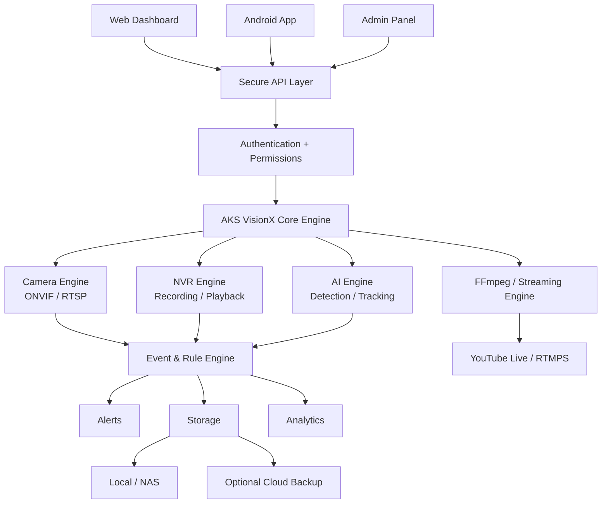

# 🛡️ AKS VisionX

<p align="center">
  
</p>

<p align="center">
  <strong>AI Video Surveillance • NVR • Traffic Intelligence Platform</strong><br>
  A secure, modular and camera/NVR-agnostic platform for live monitoring, recording, AI analytics, events, alerts and remote access.
</p>

<p align="center">
  
  
  
  
  
  
  
</p>

---

## 📌 Project Overview

**AKS VisionX** is a long-term, modular **AI Video Surveillance + NVR + Traffic Intelligence Platform**.

The goal is to build one central system that can:

> **Connect cameras/NVRs → stream live video → record → analyse with AI → detect events → count people/vehicles → process traffic → read number plates → generate alerts → manage storage/cloud backup → stream to YouTube → provide Web + Android access.**

AKS VisionX is designed to reduce dependency on individual camera-vendor applications by prioritizing open and interoperable standards such as **ONVIF** and **RTSP**, while keeping vendor/API adapters possible where required.

> **One Platform. All Cameras. Complete Intelligence.**

---

## 🎯 Project Goals

- Camera/NVR-agnostic architecture
- Local-first surveillance and recording
- Secure authentication and role-based access
- Real-time AI detection and tracking
- People and vehicle counting
- Traffic and road intelligence
- ANPR / number-plate recognition
- Smart event and rule engine
- Protected event evidence
- Rolling local storage
- Cloud backup as an optional layer
- YouTube Live streaming
- Web dashboard + Android client
- Audit logging and system health monitoring
- Future commercial licensing

---

## 🏗️ High-Level Architecture



---

## 📷 Camera & NVR Integration

### Integration priority

1. **ONVIF**
2. **RTSP**
3. **NVR ONVIF / RTSP**
4. **Supported vendor/API adapters**

Example:

```text
Camera
  ↓
ONVIF / RTSP
  ↓
AKS VisionX
  ↓
Live / Recording / AI / Events
```

If a camera does not expose a usable video stream, protocol or supported API, software cannot access that video magically. Hardware capabilities such as microphone/PTZ also remain hardware-dependent.

### AI on non-AI cameras

The camera itself does **not** need an AI chip:

```text
Normal Camera
    ↓
RTSP Video
    ↓
AKS VisionX
    ↓
Local AI Engine
    ↓
Detection / Tracking / Counting / ANPR
```

Actual AI performance depends on resolution, FPS, model, number of cameras and available CPU/GPU hardware.

---

## ✨ Core Features

### 🔐 Authentication & Security

- Registration / login / logout
- Password reset and change
- Session management
- Logout all devices
- Login and failed-login history
- Rate limiting
- Brute-force protection
- 2FA foundation
- HTTPS
- Secure password hashing
- CSRF and input validation
- Security headers
- Protected secrets
- Audit logging

### 👥 Users & Roles

Built-in role model:

- **Super Admin**
- **Admin**
- **Operator**
- **Viewer**

Permissions can be customized, for example:

```text
Live View          ✓
View Recordings    ✓
Delete Recording   ✗
Add Camera         ✗
Manage Users       ✗
System Settings    ✗
```

### 📷 Camera Management

- ONVIF discovery
- Manual camera configuration
- RTSP configuration
- Main/sub-stream support
- Camera name and location
- Credential management
- Camera health/status
- Automatic reconnect
- Camera groups
- Camera schedules
- Camera permissions
- NVR integration

### 🖥️ Live Monitoring

- Single-camera view
- 4-grid
- 9-grid
- 16-grid
- Full screen
- Digital zoom
- Snapshot
- Audio where supported
- PTZ where supported

### 🎥 NVR & Recording

Recording modes:

- 24×7
- Motion
- AI event
- Manual
- Scheduled
- Event-based

Advanced recording:

- Pre-event recording
- Post-event recording
- Timeline playback
- Bookmarks
- Protected recordings
- Export
- Screenshot
- Multi-camera playback

---

## 💾 Background Recording & Rolling Storage

Users can select a local recording folder, for example:

```text
E:\CCTV-Recordings
```

The recorder is designed to continue while the application is minimized/backgrounded, subject to operating-system permissions, power state, network availability and camera availability.

### Rolling storage

Example:

```text
Maximum Storage = 5 GB

Recording
   ↓
Storage limit reached
   ↓
Find oldest NORMAL recording
   ↓
Delete it
   ↓
Continue recording
```

Protected event recordings are excluded from normal rolling cleanup.

Supported storage targets:

- HDD
- SSD
- NAS
- User-selected folders
- Multiple storage locations

---

## 📸 Event Evidence

Important events can create:

- Snapshot
- Event metadata
- Associated recording
- AI confidence
- Camera
- Date/time
- Event type

Event evidence can have a retention policy separate from normal rolling video storage.

Search/filter targets:

- Date
- Camera
- Event
- Person
- Vehicle
- Plate
- Traffic event
- Location

---

## 🧠 AI Engine

### Detection

- Person
- Vehicle
- Animal
- Motion
- Supported object classes

### Security intelligence

- Intrusion
- Restricted-zone detection
- Line crossing
- Loitering
- Crowd detection
- Abandoned object
- Removed object
- Camera covered
- Camera tampering
- Unusual activity

AI models and dependencies will be selected with **commercial-use licensing compatibility** in mind.

---

## 👥 People Counting

Target capabilities:

```text
People: 25
IN:     14
OUT:    11
```

- Total people
- IN/OUT
- Direction
- Zone-wise count
- Occupancy
- Crowd count

Real-time performance is hardware and workload dependent.

---

## 🚗 Vehicle Counting

Target capabilities:

- Total vehicles
- Cars
- Bikes / motorcycles
- Trucks
- Buses
- Auto/rickshaw
- Other supported classes
- IN/OUT
- Direction
- Tracking
- Lane-wise count

---

## 🛣️ Traffic & Road Intelligence

For suitable road-camera deployments:

- Vehicle count
- Lane count
- Traffic density
- Congestion
- Direction
- Peak traffic periods
- Stopped vehicle detection
- Wrong-way detection
- Lane crossing
- Restricted zones
- Traffic events
- Estimated speed where technically feasible

Example dashboard concept:

```text
ROAD — LIVE

Vehicles: 47
Cars:      25
Bikes:     17
Truck:      3
Bus:        2

Traffic: HIGH
```

---

## 🔢 ANPR / Number Plate Recognition

Target pipeline:

```text
Camera
  ↓
Vehicle Detection
  ↓
Vehicle Tracking
  ↓
Plate Detection
  ↓
Plate Crop
  ↓
OCR
  ↓
Plate Text
  ↓
Database / Event
```

Example:

```text
Vehicle:   Car
Plate:     UP32AB1234
Confidence: 96%
Direction:  IN
Camera:     Main Road
```

Low-confidence OCR should remain reviewable instead of being treated as unquestionably correct.

---

## 🚨 Smart Rule Engine

Rules can combine conditions:

```text
IF
  Person detected
  AND Camera = Main Gate
  AND Time = 22:00–06:00

THEN
  Critical Alert
  + Snapshot
  + Recording Protection
```

Watchlist example:

```text
IF
  Vehicle detected
  AND Plate = Watchlist Plate

THEN
  Critical Alert
  + Snapshot
  + Recording Protection
```

Alert cooldowns should prevent notification floods from repeated detections.

---

## 🔔 Alerts

Planned channels:

- Dashboard
- Desktop
- Email
- Telegram
- Android push
- Sound
- Critical alerts

---

## 🔎 Smart Search

Structured search:

- Date/time
- Camera
- Location
- Event type
- Person
- Vehicle
- Plate
- Traffic
- Intrusion

Future direction:

> “Kal raat gate par vehicle wale events dikhao.”

Natural-language search will be added only after the underlying event metadata is reliable.

---

## ▶️ Playback

- Timeline
- Event markers
- Play/pause
- Fast-forward
- Rewind
- Bookmark
- Snapshot
- Export
- Download
- Multi-camera playback

---

## ☁️ Optional Cloud Backup

Possible integrations:

- Google Drive
- OneDrive
- S3-compatible storage
- Other supported providers

Cloud is intended as an **optional backup layer**, not a mandatory dependency for core local surveillance.

---

## 🔴 YouTube Live

Camera does not need native YouTube support.

```text
Camera
  ↓
RTSP
  ↓
AKS VisionX
  ↓
FFmpeg / Streaming Engine
  ↓
RTMPS
  ↓
YouTube
```

Target features:

- Start/stop
- Stream profiles
- Resolution
- FPS
- Bitrate
- Health monitoring
- Auto reconnect
- Scheduling

YouTube should not be treated as the primary CCTV archive.

---

## 🌐 Web Application

Planned dashboard areas:

```text
Dashboard
Cameras
Live
Recordings
Events
AI Analytics
ANPR
Alerts
Traffic
Storage
Cloud
YouTube
Users
Reports
Settings
License
Audit
```

---

## 📱 Android Application

The Android client will use the central backend rather than exposing camera credentials directly.

```text
Android
   ↓
HTTPS
   ↓
AKS VisionX API
   ↓
Backend
   ↓
Camera / NVR
```

Planned features:

- Login/logout
- Live view
- Alerts
- Events
- Playback
- Snapshots
- Notifications
- Camera status
- User profile
- Secure remote access

---

## 🩺 System Health

Example:

```text
CPU        32%
RAM        54%
Storage    68%
Network    GOOD

Camera 01  ONLINE
Camera 02  ONLINE
Camera 03  OFFLINE

AI         RUNNING
Recorder   RUNNING
```

---

## 📝 Audit Logs

Security-sensitive actions should be auditable:

- Login
- Logout
- Failed login
- Camera added/removed
- Recording deleted
- User created
- Permission changed
- Settings changed
- YouTube stream started
- License activated

---

## 📊 Reports

Planned reports:

- Camera uptime
- Offline cameras
- AI events
- People counts
- Vehicle counts
- Traffic statistics
- ANPR history
- Storage usage
- Alert history

Export targets:

- PDF
- CSV

---

## 🗺️ Floor Plan / Camera Map

Users can place cameras on a floor-plan/map style view:

```text
┌─────────────────────────┐
│ 📷 Camera 1             │
│                         │
│          🏢             │
│                         │
│ 📷 Camera 2       🚪    │
└─────────────────────────┘
```

Selecting a camera can open its live view.

---

## 🪪 Licensing

Future commercial licensing model:

- Trial
- Home
- Business
- Professional
- Enterprise

Potential license controls:

- License key
- Activation
- Expiry
- Renewal
- Revoke
- Camera limit
- Device limit
- Signed license
- Offline grace period
- License status

A separate **License Admin/Generator** is planned for authorized administration.

---

## 🧰 Technology Stack

| Layer | Technology |
|---|---|
| Backend | Python + Django |
| API | Django REST Framework |
| Database | SQLite → PostgreSQL |
| Video | FFmpeg + OpenCV |
| Camera | ONVIF + RTSP |
| AI | Local / open-source compatible models |
| OCR | Local OCR engine |
| Frontend | HTML / CSS / JavaScript initially |
| Android | Android client |
| Streaming | FFmpeg + RTMPS |
| Storage | Local / NAS / optional cloud |

> Final AI model selection will be based on accuracy, performance, hardware requirements and commercial-use licensing.

---

## 📁 Target Project Structure

```text
AKS-VisionX/
│
├── backend/
├── accounts/
├── cameras/
├── recordings/
├── events/
├── alerts/
├── ai_engine/
├── storage_manager/
├── cloud_backup/
├── youtube_live/
├── dashboard/
├── audit/
│
├── media/
│   ├── recordings/
│   ├── snapshots/
│   └── exports/
│
├── logs/
├── docs/
├── tests/
├── config/
│
├── manage.py
├── requirements.txt
├── .env
└── .gitignore
```

The structure will be refined during architecture implementation.

---

## 🔐 Security Principles

AKS VisionX will **not** claim to be “100% unhackable.” Instead, security is treated as a first-class engineering requirement.

### Application security

- HTTPS
- Secure password hashing
- Session security
- API authentication
- Authorization
- CSRF protection
- Rate limiting
- Brute-force protection
- Input validation
- Security headers
- Secure file handling
- Secret management
- Audit logging

### Camera security

- No hard-coded credentials
- Protected camera credentials
- No unnecessary public exposure
- Private-network/VPN approach where appropriate
- Secure remote architecture

---

## ⚠️ Known Limitations

AKS VisionX will respect real hardware and network limitations:

- No microphone hardware → no audio capture
- No PTZ hardware → software cannot create physical PTZ
- No usable camera/NVR stream or supported API → integration may be impossible
- Low-quality/distant plate → ANPR accuracy can decrease
- Weak hardware + many cameras → AI FPS/performance can decrease
- PC sleep/off → local recording stops
- Internet outage → remote/cloud/YouTube can be affected, while local recording may continue if the local system and cameras remain available

---

## 🧪 Development Method

Every phase follows:

```text
BUILD
  ↓
TEST
  ↓
FIX
  ↓
VERIFY
  ↓
COMMIT
  ↓
NEXT PHASE
```

Example:

```text
Phase 4
  ↓
CP-T31A discovered
  ↓
RTSP verified
  ↓
Live verified
  ↓
Recording verified
  ↓
Reconnect verified
  ↓
TEST PASSED
  ↓
Phase 5
```

---

## 🏗️ Development Roadmap

### Phase 1 — Foundation
Python, Django, environment, architecture, database, Git.

### Phase 2 — Authentication
Login, logout, registration, password management, sessions, 2FA foundation.

### Phase 3 — Users & Roles
Admin, Operator, Viewer and permissions.

### Phase 4 — Camera Engine
ONVIF, RTSP, camera discovery, NVR and multi-camera support.

### Phase 5 — NVR
Recording, playback, snapshots, pre/post-event recording.

### Phase 6 — Storage
Local folders, rolling storage, protected events and NAS.

### Phase 7 — AI
Detection, tracking, counting, traffic intelligence and ANPR.

### Phase 8 — Events & Alerts
Rules, notifications, event history and search.

### Phase 9 — Cloud
Backup policies, retries and provider integrations.

### Phase 10 — YouTube
Live streaming, profiles and health monitoring.

### Phase 11 — Web + Android
Complete dashboards, remote access and push notifications.

### Phase 12 — Production
Security hardening, performance, installer, updates, licensing and commercial deployment.

---

## 🚀 Getting Started

> **Current status:** architecture/specification stage. The implementation should begin only after the architecture is frozen.

Planned local workspace:

```text
E:\AKS-VisionX
```

Initial setup direction:

```bash
git clone <your-repository-url>
cd AKS-VisionX

python -m venv .venv
# Windows:
.venv\Scripts\activate

pip install -r requirements.txt

python manage.py migrate
python manage.py runserver
```

The exact dependency list, environment variables and Django apps will be committed as implementation progresses.

---

## 🤝 Contributing

Contributions, architecture discussions and testing feedback are welcome.

Before submitting changes:

1. Keep modules isolated and maintainable.
2. Add tests for new behavior.
3. Never commit passwords, camera credentials, API keys or `.env` secrets.
4. Document security-sensitive changes.
5. Follow the **Build → Test → Fix → Verify → Commit** workflow.

See `CONTRIBUTING.md` when the contribution workflow is finalized.

---

## 📜 License

The licensing model is **not finalized yet**.

This repository should not be assumed to grant commercial redistribution rights until a `LICENSE` file is explicitly added and finalized.

---

## ⭐ Vision

AKS VisionX is intended to evolve from a local CCTV/NVR application into a complete surveillance intelligence platform:

```text
Cameras / NVR
      ↓
Live Monitoring
      ↓
Recording
      ↓
AI Detection
      ↓
Tracking & Counting
      ↓
Traffic + ANPR
      ↓
Events + Rules
      ↓
Alerts + Evidence
      ↓
Analytics + Reports
      ↓
Web + Android + Cloud
```

**AKS VisionX — Secure. Modular. Intelligent. Camera-Agnostic.**
